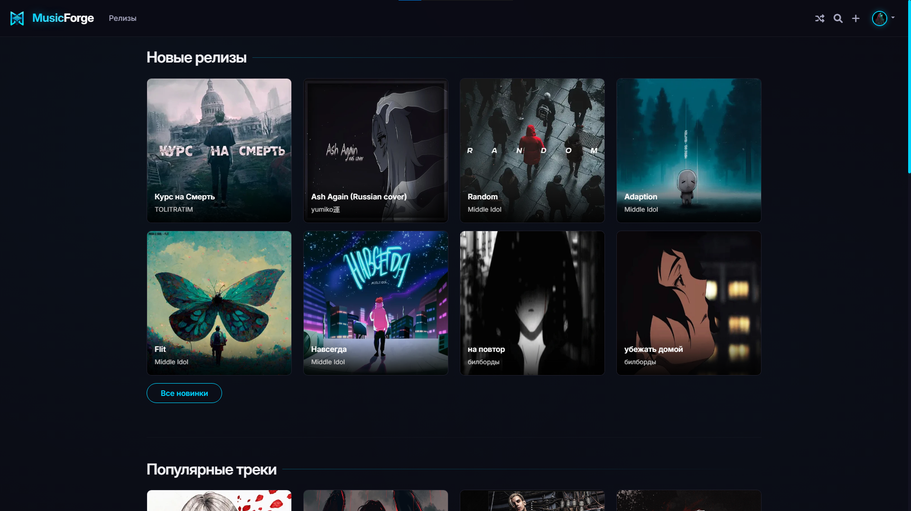

# MusicForge Web

Серверная часть экосистемы **MusicForge**: REST API, веб-интерфейс и движок рекомендаций для вашей собственной музыкальной платформы. Написан на Python с использованием Flask.



## Основные возможности

- **Полноценный Web-интерфейс**: Стильный неоновый дизайн, кастомный плеер с субтитрами (SRT), визуализацией и мини-плеером при переключении страниц.
- **REST API v1**: Защищенный API для десктопного клиента (и сторонних приложений) с поддержкой Access/Refresh токенов (JWT-подобная схема).
- **Умные рекомендации**: Гибридный движок, сочетающий коллаборативную фильтрацию (User/Item-based) и контентную (по тегам и артистам).
- **Обработка медиа**: 
  - Загрузка аудио (MP3, WAV, OGG, M4A).
  - Импорт треков напрямую с YouTube.
  - Обложки (WebP) и видео-клипы (WebM).
- **Безопасность**: 
  - Хэширование паролей (Werkzeug).
  - Защита от CSRF (Flask-WTF).
  - Ограничение частоты запросов (Flask-Limiter).
  - OAuth 2.0 авторизация (Google, GitHub).
- **Интеграции**:
  - Webhooks для событий (прослушивание, загрузка) с HMAC-подписью.
  - WebSockets (Flask-Sock) для живых виджетов "Сейчас играет".
- **OpenAPI / Swagger**: Встроенная интерактивная документация API.

## Требования

Перед запуском убедитесь, что в системе установлены:
1. **Python 3.10+**.
2. **FFmpeg**.
3. **yt-dlp**.

## Установка и запуск

Установка библиотек:
```bash
pip install -r requirements.txt
```

Запуск сервера:
```bash
python app.py
```

## Конфигурация (Переменные окружения)

Вы можете настроить сервер, задав переменные окружения (например, через файл `.env` или в настройках Docker/системы).

| Переменная | По умолчанию | Описание |
| :--- | :--- | :--- |
| `HOST` | `0.0.0.0` | IP-адрес для прослушивания. |
| `PORT` | `5000` | Порт сервера. |
| `FLASK_DEBUG` | `0` | Включить режим отладки (`1` - вкл, `0` - выкл). |
| `SECRET_KEY` | *авто* | Секретный ключ Flask (если не задан, создастся файл `.secret_key`). |
| `DATABASE_URI` | `sqlite:///musicforge.db` | Строка подключения к БД (SQLAlchemy). |
| `MAX_UPLOAD_MB` | `500` | Максимальный размер загружаемого файла в МБ. |
| `ENFORCE_TOKEN_EXPIRY` | `1` | Проверять ли срок действия API-токенов. |
| `ACCESS_TOKEN_TTL_DAYS` | `30` | Время жизни Access-токена (в днях). |
| `REFRESH_TOKEN_TTL_DAYS` | `90` | Время жизни Refresh-токена (в днях). |
| `COOKIE_SECURE` | `0` | Устанавливать флаг `Secure` для cookie (включайте при работе через HTTPS). |
| `ALLOWED_ORIGINS` | *пусто* | Разрешенные CORS-домены (через запятую) для API. |
| `RATELIMIT_STORAGE_URI` | `memory://` | Хранилище для лимитов (например, `redis://localhost:6379`). |

### Настройка OAuth (Опционально)
Для входа через сторонние сервисы добавьте:
* `GOOGLE_CLIENT_ID`, `GOOGLE_CLIENT_SECRET`
* `GITHUB_CLIENT_ID`, `GITHUB_CLIENT_SECRET`

## Документация API

Сервер предоставляет полную интерактивную документацию (Swagger UI), которая генерируется автоматически.
После запуска сервера перейдите по адресу:
-> **`http://localhost:5000/api/v1/docs`**

API использует `Bearer` токены. Получить их можно через эндпоинты `/api/v1/auth/login` или `/api/v1/auth/register`.

## Структура проекта

```
├── app.py                  # Главный файл (роуты, API)
├── models.py               # Модели базы данных (SQLAlchemy)
├── requirements.txt        # Зависимости Python
│
├── static/                 # Статические файлы
│   ├── styles.css          # Основные стили интерфейса
│   ├── favicon.ico         # Иконка сайта
│   ├── default_avatar.webp # Аватар по умолчанию
│   ├── default_cover.webp  # Обложка трека по умолчанию
│   └── users/              # Медиафайлы пользователей
│
└── templates/              # HTML-шаблоны
```